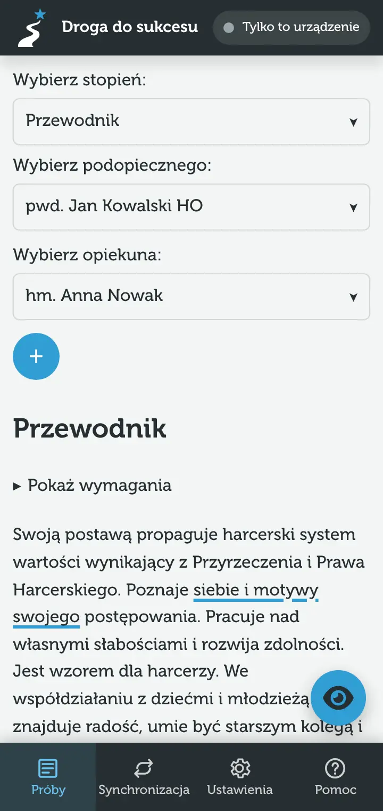

An advancement is one person's plan for earning one rank. It consists of tasks, and every task covers some requirements and a part of the rank idea.

## New advancement {#nowa-proba}

On the list choose “Add new advancement”. It starts with the first rank on the list and the first person as mentee and mentor – change them right away at the top of the advancement. If there are no people yet, the app asks you to add one first.

## Rank, mentee and mentor {#stopien-podopieczny-i-opiekun}

At the top of the advancement there are three lists:

- **Select rank** – the rank the advancement is for.
- **Select mentee** – the person doing the advancement.
- **Select mentor** – the person running it.

The round “+” button adds a new person. Mentee and mentor can be changed at any time: tasks stay as they are, and the “Mentor” / “Mentee” labels next to comments update by themselves.

## Changing the rank {#zmiana-stopnia}

Tasks are written for the idea and requirements of a specific rank, so **changing the rank deletes all tasks of the advancement** together with their comments. It also deletes comments on the previous rank's requirements – the confirmation tells you how many. General notes stay.

> [!WARNING]
> The deletion also reaches the devices you sync with. If in doubt, make a [backup](/pomoc/kopie-zapasowe) first.

## Rank idea {#idea-stopnia}

Under the rank name there is its idea. Parts of the idea already covered by tasks are underlined, so you can see at a glance what is missing. You assign a part of the idea in the task card, see [Tasks](/pomoc/zadania#fragment-idei).

## Initial, final and task requirements {#wymagania-startowe-koncowe-i-wymagania-w-zadaniach}

- **Show requirements** – initial requirements (to open the advancement) and final ones (to close it). Shown for ranks that have them.
- **Show selected requirements in tasks** – all requirements of the rank, marked as covered or not by some task. Every requirement also has a [comments](/pomoc/komentarze) button.

## Deleting an advancement {#usuwanie-proby}

On the list every advancement has a red bin button. Deleting removes the advancement with its tasks and comments, also on connected devices. The app always asks for confirmation.
