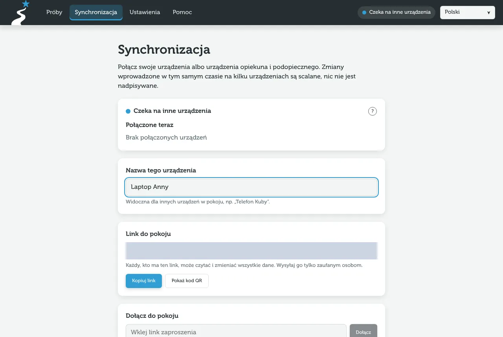

Sync connects devices into a **room**. All devices in a room have the same data, and changes from one show up on the others within a second. Changes made at the same time are merged – nothing is overwritten.

## How to connect devices {#jak-polaczyc-urzadzenia}

1. On the first device (the one that already has the data) open the **Sync** tab and choose **Create a room**.
2. Pass the room link to the other device: **Copy link**, **Share link** or **Show QR code**.
3. On the other device open the link (or scan the code with the camera). You can also paste the link into “Join a room”.
4. After a moment both devices show “Synced with 1 device”.

> [!WARNING]
> **The link is the key to all the data.** Anyone who has it can read and change advancements, tasks and comments. Only send it to people you trust.

## Link and QR code {#link-i-kod-qr}

The link looks like `…/dolacz#r=…&k=…`. The part after `#` is the room name and the encryption key. This part never reaches the server, and after joining the app removes it from the address bar. The QR code contains the same link – the easiest way to move access from a computer to a phone.

## Sync states {#stany-synchronizacji}

The state is shown in the header (on a computer) or as a dot on the “Sync” tab (on a phone):

| State | Meaning |
|---|---|
| **Synced with n devices** (green) | The connection works, the data is up to date. |
| **Waiting for other devices** (blue) | Your device is in the room, but no other device has the app open right now. |
| **Waiting for connection** (orange) | Connecting. If it takes long, see [troubleshooting](/pomoc/problemy#nie-widze-zmian-z-drugiego-urzadzenia). |
| **No internet connection** (red) | You are offline. Changes are saved on the device and sent when the internet is back. |
| **This device only** (grey) | The device is not in any room. |

> [!NOTE]
> Data flows **directly between devices**. Sync therefore works only while at least two devices have the app open at the same time. When that is not possible, move the data with a [backup](/pomoc/kopie-zapasowe).

## Device name and connected devices {#nazwa-urzadzenia-i-lista-polaczonych}

In **Name of this device** type e.g. “Kuba's phone”. Other devices see this name in **Connected now**. The list shows devices that currently have the app open in this room.

## Merge or start from the room's data {#scal-czy-zacznij-od-danych-pokoju}

If you join a room on a device that already has some data, the app asks what to do with it:

- **Merge with the room** – your data and the room's data are combined. Choose this when both devices have different advancements you need.
- **Start from the room's data** – the device takes only the room's data. Choose this when your data is e.g. a test advancement or a duplicate. Your previous data is not lost: it is kept as a backup in [Settings](/pomoc/kopie-zapasowe#kopia-sprzed-zacznij-od-danych-pokoju).

> [!TIP]
> On a new device join the room first and only then add people and advancements. This way you avoid duplicated people.

## Change room {#zmien-pokoj}

**Change room (revoke access)** creates a new room with a new key. Devices with the old link stop syncing and get no new changes. Use it when:

- you lose a phone that was in the room,
- the link reached the wrong person,
- you stop working with someone who had access.

After the change send the new link only to the devices that should stay. Data already on the old devices stays there – changing the room does not delete it.

## Leave room {#opusc-pokoj}

**Leave room** turns sync off on this device. The data stays here, and other devices keep their copies.
