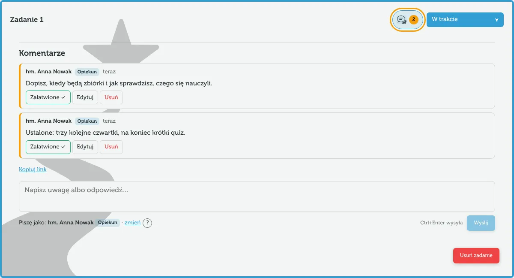
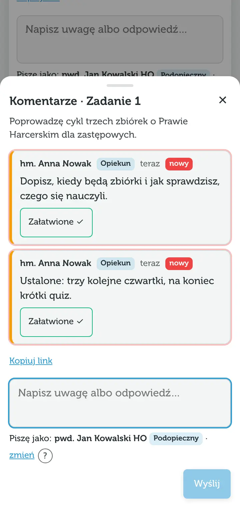

Komentarze to rozmowa opiekuna z podopiecznym przy konkretnym punkcie próby. Każda uwaga jest **otwarta**, dopóki ktoś nie oznaczy jej jako **załatwionej**. Żeby komentarze widziały obie osoby, połączcie urządzenia [synchronizacją](/pomoc/synchronizacja).

## Gdzie zostawić uwagę

| Gdzie | Przycisk | Do czego |
|---|---|---|
| **Zadanie** | dymek w nagłówku karty, obok statusu | uwagi do treści, terminu, sposobu realizacji |
| **Wymaganie** | dymek przy wymaganiu w „Pokaż wybrane wymagania w zadaniach” | np. „do tego wymagania brakuje zadania” |
| **Uwagi ogólne** | sekcja pod ideą, nad zadaniami | uwagi do całej próby |

Liczba przy dymku to **otwarte** uwagi (pomarańczowe tło). Szara liczba oznacza, że wszystkie są już załatwione. Na komputerze wątek zadania rozwija się w karcie, a na telefonie otwiera się w panelu od dołu ekranu.

## Dla opiekuna

- Otwórz próbę podopiecznego i stuknij dymek przy zadaniu albo wymaganiu. Napisz uwagę i wybierz „Wyślij” (na komputerze także Ctrl+Enter, na Macu ⌘+Enter).
- Nad zadaniami pojawi się panel **Otwarte uwagi** – lista wszystkich nierozwiązanych spraw w tej próbie. „Pokaż” przenosi do właściwego miejsca i otwiera wątek.
- Na liście prób każda próba z otwartymi uwagami ma pomarańczową plakietkę, np. „2 otwarte uwagi”.

## Dla podopiecznego

- Odpowiedz w tym samym wątku – wątek jest płaski, wpisy idą po kolei.
- Gdy poprawisz to, czego dotyczyła uwaga, wybierz przy niej **Załatwione ✓**. Załatwione uwagi zwijają się pod „Pokaż załatwione (n)”.
- „Otwórz ponownie” przywraca uwagę, jeśli sprawa jednak wraca.

Oznaczyć uwagę jako załatwioną może każdy – tak jak każdy z linkiem do pokoju może zmieniać dane. Warto umówić się z opiekunem, kto to robi.

## Piszę jako

Aplikacja nie ma kont, więc przy pierwszym komentarzu pyta: **„Kto pisze na tym urządzeniu?”**. Na górze listy są opiekun i podopieczny tej próby. Brakuje Cię? Wybierz „Dodaj osobę”.

Wybór zapamiętuje się **tylko na tym urządzeniu**. Zmienisz go linkiem „zmień” pod polem komentarza albo w [Ustawieniach](/pomoc/ustawienia#pisze-jako). Etykieta „Opiekun” albo „Podopieczny” przy autorze wynika z ustawień próby, więc po zmianie opiekuna próby etykiety same się zaktualizują.

## Dlaczego mogę edytować tylko swoje komentarze

Przyciski „Edytuj” i „Usuń” są tylko przy komentarzach osoby wybranej w „Piszę jako” na tym urządzeniu. To **ochrona przed pomyłką, nie zabezpieczenie**: każdy, kto ma link do pokoju, może wybrać dowolną osobę. Edytowany komentarz ma dopisek „edytowano”.

## Kropka „nowe”

Czerwona kropka przy dymku i znacznik „nowy” przy wpisie oznaczają komentarze innych osób napisane od Twojej ostatniej wizyty w tej próbie. Wizyta liczy się do wyjścia z próby albo zamknięcia aplikacji, więc kropki nie znikają, gdy jeszcze czytasz. Aplikacja nie wysyła powiadomień – nie ma serwera, który by je wysłał.

## Link do wątku

„Kopiuj link” pod wątkiem kopiuje adres, który otwiera próbę od razu na tym wątku, np. `…/stopien/…#zadanie-…`. Możesz go wysłać w komunikatorze. Link działa na urządzeniach, które są w tym samym [pokoju synchronizacji](/pomoc/synchronizacja).

## Komentarze w PDF i w eksporcie

Komentarze **nie trafiają do PDF**, chyba że w podglądzie zaznaczysz „Dołącz komentarze” – zobacz [Podgląd i PDF](/pomoc/pdf#komentarze-w-pdf). Eksport JSON zawiera komentarze zawsze.

> [!NOTE]
> Zmiana stopnia próby usuwa komentarze do wymagań poprzedniego stopnia, a usunięcie zadania – jego komentarze. Okno potwierdzenia mówi o tym wcześniej.
