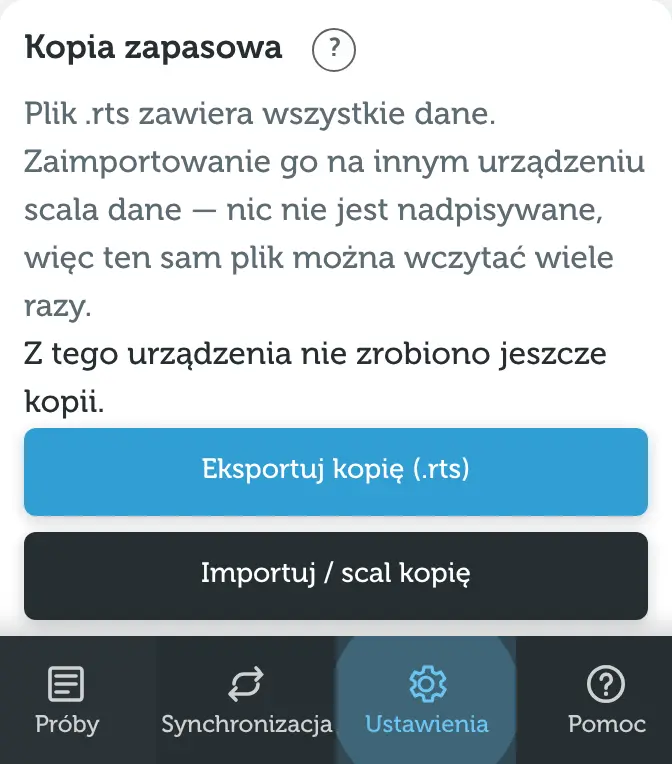

Dane są tylko na Twoich urządzeniach. Gdyby wszystkie zginęły albo przeglądarka usunęła dane, kopia zapasowa jest jedynym sposobem, żeby je odzyskać.

## Eksport kopii (.rts)

W **Ustawieniach** wybierz **Eksportuj kopię (.rts)**. Plik zawiera wszystkie dane: osoby, próby, zadania i komentarze. Na telefonie otworzy się menu udostępniania – zapisz plik w Plikach, na Dysku albo wyślij go sobie mailem.

Nazwa pliku zawiera datę, np. `road-to-success-2026-10-19.rts`.

## Eksport do JSON

**Eksportuj do JSON (do odczytu)** tworzy plik tekstowy, który można otworzyć w edytorze albo przetworzyć programem. Zawiera osoby, próby, zadania i komentarze. **Nie da się go zaimportować** – do kopii zapasowych używaj pliku `.rts`.

## Import i scalanie

**Importuj / scal kopię** (w Ustawieniach) albo kafelek **Zaimportuj kopię** na liście prób:

1. Wybierz plik `.rts`.
2. Aplikacja sprawdzi plik i pokaże, ile osób, prób i zadań jest w kopii oraz ile będzie na urządzeniu po scaleniu.
3. Wybierz **Scal**.

Import **niczego nie nadpisuje** – dane z pliku łączą się z danymi na urządzeniu. Ten sam plik można wczytać wiele razy, a ponowny import nic nie zmienia.

> [!WARNING]
> Starsza kopia nie przywróci czegoś, co usunięto później w tych samych danych: usunięcie jest nowszą zmianą i „wygrywa”. Żeby zajrzeć do starej wersji, zaimportuj kopię w innej przeglądarce albo w oknie, które nie jest w pokoju synchronizacji.

Plik z nowszej wersji aplikacji zostanie odrzucony z prośbą o aktualizację – odśwież wtedy stronę.

## Przypomnienie o kopii

Na liście prób i w ekranie synchronizacji pojawia się przypomnienie **Zrób kopię zapasową**, gdy:

- od ostatniej kopii z tego urządzenia minęło 14 dni, albo
- kopii nie było jeszcze nigdy, a dane mają kilka dni.

**Eksportuj teraz** robi kopię od razu, **Później** odkłada przypomnienie o 3 dni.

## Kopia sprzed „Zacznij od danych pokoju”

Gdy przy dołączaniu do pokoju wybierzesz [Zacznij od danych pokoju](/pomoc/synchronizacja#scal-czy-zacznij-od-danych-pokoju), poprzednie dane tego urządzenia zostają zachowane. W **Ustawieniach** zobaczysz „Kopia danych sprzed dołączenia do pokoju” z dwiema opcjami:

- **Pobierz kopię** – zapisuje ją jako plik `.rts`,
- **Scal z powrotem** – łączy ją z obecnymi danymi (także z danymi pokoju).
