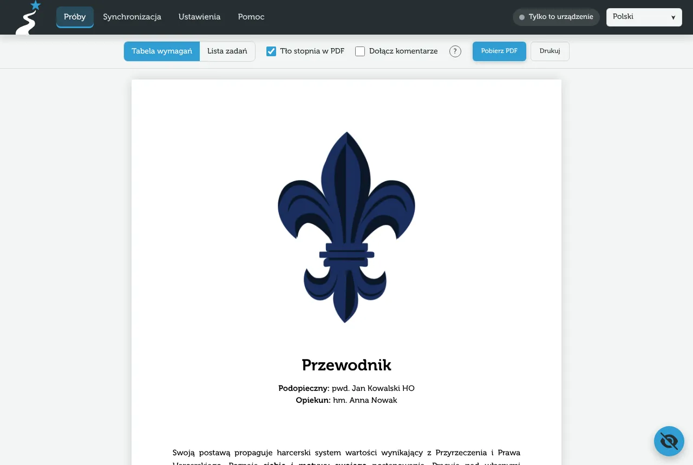

Z danych próby aplikacja tworzy dokument PDF – bez internetu i bez wysyłania czegokolwiek na serwer.

## Podgląd dokumentu

W widoku próby stuknij okrągły przycisk z okiem w prawym dolnym rogu („Podgląd dokumentu”). Ten sam przycisk wraca do edycji. Podgląd pokazuje dokładnie to, co trafi do PDF.

## Opcje podglądu

### Układ: tabela wymagań czy lista zadań

- **Tabela wymagań** – każde wymaganie stopnia z zadaniami, które je realizują. Dobra do sprawdzenia, czy próba „pokrywa” wszystkie wymagania. Na telefonie zamiast tabeli są karty.
- **Lista zadań** – zadania po kolei: treść, status, fragment idei i wymagania.

W obu układach na pierwszej stronie jest stopień, podopieczny, opiekun i idea z podkreślonymi fragmentami. Aplikacja zapamiętuje wybrany układ.

### Tło stopnia

„Tło stopnia w PDF” kładzie pod każdą stronę grafikę stopnia (kolorowy pasek i logotypy). Bez tła PDF jest lżejszy i lepiej nadaje się do druku w czerni i bieli.

### Komentarze w PDF

PDF to zwykle dokument do oddania, dlatego **komentarze domyślnie nie są dołączane**. Zaznacz „Dołącz komentarze”, a potem wybierz:

- **Tylko otwarte** – uwagi, które nie zostały jeszcze załatwione,
- **Wszystkie** – także załatwione (z dopiskiem „załatwione”).

W układzie listy komentarze są pod swoim zadaniem, a uwagi ogólne i do wymagań w sekcji „Uwagi” na końcu. W układzie tabeli wszystkie komentarze są w sekcji „Uwagi” na końcu, z odnośnikami „Zad. 2”, „Wym. 5”, „Ogólne”.

## Zapis i udostępnianie

Wybierz „Pobierz PDF”. Co dzieje się dalej, zależy od urządzenia:

:::ios
1. Otworzy się arkusz udostępniania. Wybierz **Zachowaj w Plikach**, żeby zapisać dokument, albo od razu wyślij go w Wiadomościach, poczcie czy komunikatorze.
2. Jeśli arkusz się nie pojawi, PDF otworzy się w nowej karcie – użyj tam przycisku udostępniania.
3. Gdy tworzenie PDF trwało dłużej, pojawi się okno „PDF gotowy” – stuknij **Udostępnij** albo **Pobierz**.
:::

:::android
1. Otworzy się menu udostępniania – wybierz aplikację (np. Dysk, Gmail, komunikator) albo zapis do plików.
2. Jeśli menu się nie pojawi, plik trafi do „Pobranych”.
3. Gdy tworzenie trwało dłużej, w oknie „PDF gotowy” wybierz **Udostępnij** albo **Pobierz**.
:::

:::desktop
Plik pobierze się do folderu pobranych plików, z nazwą w rodzaju `przewodnik-jan-kowalski.pdf`.
:::

> [!TIP]
> PDF działa offline. Jeśli coś pójdzie nie tak, zajrzyj do [rozwiązywania problemów](/pomoc/problemy#pdf-nie-pobiera-sie-na-iphonie).

## Drukowanie

Pobierz PDF i wydrukuj go z programu, w którym go otworzysz (przeglądarka, Podgląd, Adobe Reader albo aplikacja Pliki na telefonie). Do druku w czerni i bieli wyłącz wcześniej „Tło stopnia w PDF”.
