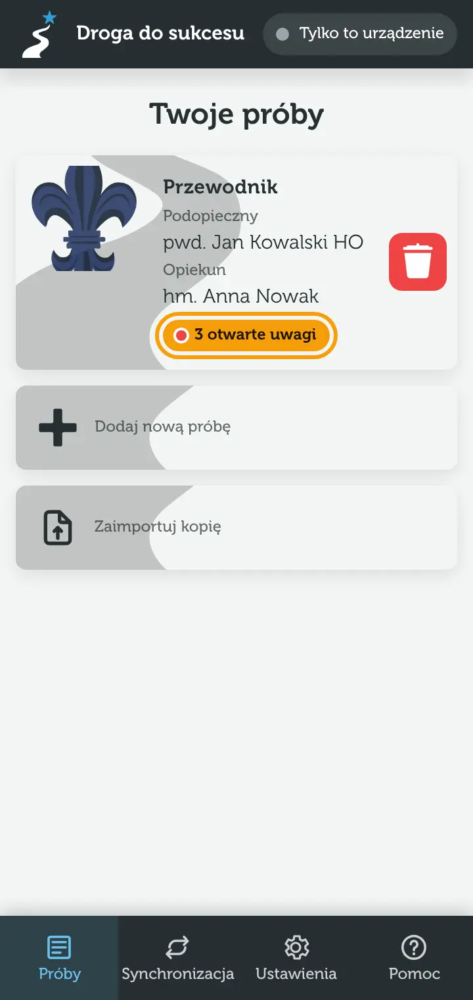

Droga do sukcesu pomaga zaplanować i poprowadzić próbę na stopień harcerski albo instruktorski. Podopieczny pisze zadania, przypisuje do nich wymagania i fragmenty idei stopnia, a opiekun zostawia uwagi. Na końcu aplikacja tworzy z tego dokument PDF.

## Gdzie są moje dane

Wszystko zapisuje się **na Twoim urządzeniu** – w przeglądarce, bez konta i bez serwera z danymi. Aplikacja działa też bez internetu. Jeśli chcesz pracować na kilku urządzeniach (np. telefon i komputer albo Ty i Twój opiekun), połącz je [synchronizacją](/pomoc/synchronizacja).

> [!TIP]
> Jeśli dane są już na innym urządzeniu, **nie dodawaj niczego od nowa**. Na ekranie powitalnym wybierz „Dołącz do synchronizacji” albo „Importuj kopię zapasową”. Unikniesz zdublowanych osób i prób.

## Pierwsza próba w 3 krokach

1. **Dodaj siebie.** Na ekranie powitalnym wybierz „Dodaj pierwszą osobę” i wpisz imię, nazwisko i stopień, np. „pwd. Jan Kowalski HO”. Później w ten sam sposób dodasz opiekuna albo podopiecznych (przycisk „+” w widoku próby).
2. **Załóż próbę.** Na liście prób stuknij „Dodaj nową próbę”. Aplikacja otworzy nową próbę na pierwszy stopień z listy.
3. **Ustaw szczegóły.** U góry próby wybierz stopień, podopiecznego i opiekuna. Potem dodaj pierwsze zadanie przyciskiem „Dodaj zadanie” – więcej w poradniku [Zadania](/pomoc/zadania).

## Co dalej

- Pracujesz z opiekunem? Połączcie urządzenia w [synchronizacji](/pomoc/synchronizacja) – zobaczycie te same zadania i [komentarze](/pomoc/komentarze).
- Zainstaluj aplikację na ekranie głównym telefonu – [jak to zrobić](/pomoc/instalacja).
- Co jakiś czas zrób [kopię zapasową](/pomoc/kopie-zapasowe). Aplikacja sama o niej przypomni.

> [!NOTE]
> Nie znasz któregoś słowa, np. „idea stopnia” albo „pokój”? Zajrzyj do [słowniczka](/pomoc/slowniczek).
