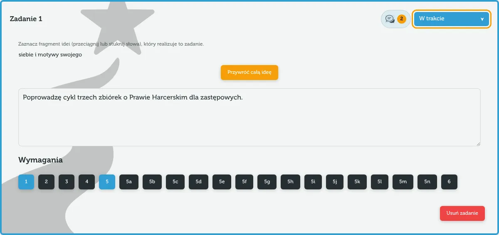

Zadanie to jedna rzecz, którą podopieczny zrobi w ramach próby, np. „Poprowadzę cykl zbiórek o Prawie Harcerskim”. Każde zadanie ma treść, [status](/pomoc/statusy), przypisane wymagania i fragment idei stopnia.

## Dodawanie zadania

Pod listą zadań stuknij „Dodaj zadanie”. Nowa karta pojawi się na końcu, z numerem i statusem „Stworzone”.

## Treść zadania

Wpisz treść w dużym polu tekstowym. Zapisuje się sama, przy każdym znaku – nie ma przycisku „Zapisz”.

> [!NOTE]
> Treść można pisać **jednocześnie na dwóch urządzeniach**, np. podopieczny na telefonie, a opiekun na komputerze. Zmiany łączą się znak po znaku i nic nie jest nadpisywane, także gdy jedno z urządzeń było chwilę offline.

## Fragment idei

Nad treścią jest idea stopnia. Wskaż, którą jej część realizuje zadanie:

- **Na telefonie** stuknij kolejne słowa – zostaną zaznaczone.
- **Na komputerze** przeciągnij myszą po fragmencie albo klikaj słowa.

Potem wybierz „Zapisz”. „Przywróć całą ideę” usuwa wybór. Zapisane fragmenty są podkreślone w idei na górze próby i w PDF.

## Wymagania zadania

Pod treścią są wymagania stopnia:

- **Na szerokim ekranie** to przyciski z numerami. Najedź myszą, żeby zobaczyć treść wymagania. Kliknięcie dodaje albo usuwa wymaganie (wybrane są podświetlone).
- **Na telefonie i tablecie** rozwiń „Wymagania · wybrano: n” i zaznacz pola przy wymaganiach – z pełną treścią.

Jedno wymaganie może być w kilku zadaniach. Lista „Pokaż wybrane wymagania w zadaniach” na górze próby pokazuje, które wymagania nie mają jeszcze żadnego zadania.

## Kolejność

Zadania mają numery w kolejności dodania: „Zadanie 1”, „Zadanie 2” itd. Te same numery są w dokumencie PDF i w odnośnikach „Zad. 2” przy komentarzach. Usunięcie zadania przesuwa numery kolejnych.

## Usuwanie zadania

Na dole karty jest „Usuń zadanie”. Po potwierdzeniu zadanie znika razem ze swoimi komentarzami – także na połączonych urządzeniach.
